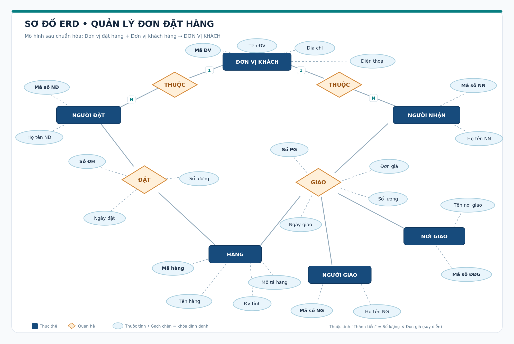

# BÀI THỰC HÀNH: QUẢN LÝ ĐƠN ĐẶT HÀNG

## Thông tin sinh viên
- Họ tên: THÀO A KHUA
- Mã sinh viên: DTC245200974
- Lớp: CNTT K23G

## Mục tiêu
Xây dựng sơ đồ thực thể liên kết ERD
cho hệ thống quản lý đơn đặt hàng.

## Nội dung thực hiện
1. Xác định các thực thể.
2. Xác định thuộc tính của thực thể.
3. Xác định các mối quan hệ.
4. Vẽ sơ đồ ERD.
5. Chuẩn hóa mô hình ERD.

## Hình ảnh sơ đồ ERD

## Kết quả
Đã hoàn thành bài thực hành vẽ sơ đồ ERD.
